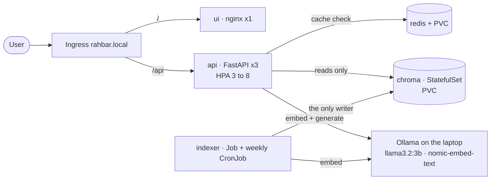
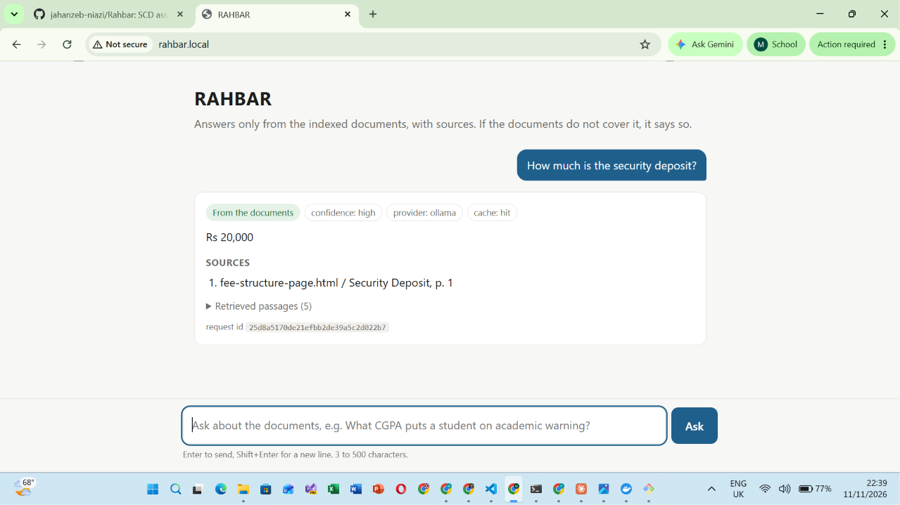

# RAHBAR: grounded answers from FAST-NUCES documents, on Kubernetes

[](https://github.com/jahanzeb-niazi/Rahbar/actions/workflows/ci.yml)
[](https://github.com/jahanzeb-niazi/Rahbar/actions/workflows/cd.yml)

A student who wants to know whether they can register after failing a prerequisite has two
bad options. They can dig through several versions of the academic rules on the
university website, or ask a general-purpose chatbot that answers confidently about some
other university's rules. **RAHBAR** answers only from a real corpus of public FAST-NUCES
documents: the 2026 academic rules, the student handbook, fee and grading pages, annual
reports and a scanned policy. It cites the passage behind every claim, prefers the current
version of a policy over the repealed one, and says so plainly when the documents do not
cover a question. It runs as a set of objects on a Kubernetes cluster. An indexer Job
builds the vector index, and three API replicas only read it. It re-indexes without a
redeploy, survives a deleted pod, and has a CI gate that fails the build when retrieval
quality drops.

## Architecture



The indexer downloads the corpus, verifies every SHA-256 against `corpus/MANIFEST.md`,
then extracts (with OCR), cleans, chunks, embeds and stores. It writes a **new collection
generation** and flips a pointer, so the API moves to the new index without a restart and
the semantic cache is invalidated (ADR 0001, ADR 0003). The API and the indexer read the
same `EMBED_MODEL` from one ConfigMap, and the API refuses readiness when the index was
built with a different model. Details are in [docs/ARCHITECTURE.md](docs/ARCHITECTURE.md).



## From a clean clone to an answered question

You need Docker, minikube, kubectl, make, Python 3.12 and [Ollama](https://ollama.com).
On Windows, run the `make` targets from Git Bash or WSL 2.

**1. Ollama on the laptop** (ollama-host mode). Generation and embeddings both go through
this one host. With minikube on Docker Desktop, the dev overlay reaches it at
`192.168.65.254:11434`, Docker Desktop's host address, which forwards to the laptop's
localhost. The default `127.0.0.1` binding is enough. On a Linux host without Docker
Desktop, start Ollama with `OLLAMA_HOST=0.0.0.0` and point `OLLAMA_URL` at the host's IP.

```bash
ollama serve
ollama pull llama3.2:3b
ollama pull nomic-embed-text
```

**2. Cluster.** Calico is required: the default CNI accepts NetworkPolicies and then
ignores them.

```bash
make cluster      # minikube start --driver=docker --cni=calico --memory=4096 --cpus=4
                  # + minikube addons enable metrics-server + minikube addons enable ingress
```

Check the address `host.minikube.internal` resolves to, and make sure it matches the
`cidr` in `k8s/overlays/dev/networkpolicy-ollama.yaml`:

```bash
minikube ssh "grep host.minikube.internal /etc/hosts"
```

**3. Images.** Build the three images and load them into minikube:

```bash
make images       # docker build api, ui, indexer (-f indexer/Dockerfile .) + minikube image load
```

**4. Apply, in this order.** One `kubectl apply -k` creates everything in the right
dependency order: the namespace, ServiceAccounts, ConfigMap, Chroma, Redis, api, ui,
Services, Ingress, NetworkPolicies and the HPA. The indexer Job starts right away; it
retries until Chroma is up (`backoffLimit: 3`).

```bash
kubectl apply -k k8s/overlays/dev
kubectl get pods -n rahbar -w                       # chroma-0, redis, ui Running
kubectl wait --for=condition=complete job/indexer -n rahbar --timeout=1800s
kubectl rollout status deployment/api -n rahbar     # api becomes 3/3 READY once the index exists
```

The first index run downloads about 35 MB and OCRs 32 pages, so allow a few minutes. The
api pods stay at 0/1 READY until the collection exists and is non-empty: that is the
readiness probe working, not a failure.

**5. Ask through the Ingress.** On Windows or macOS with the docker driver, run
`minikube tunnel` in another terminal and use `127.0.0.1`. On Linux, use `$(minikube ip)`.

```bash
make ask INGRESS_IP=127.0.0.1 Q="What CGPA puts a student on academic warning?"
make ask INGRESS_IP=127.0.0.1 Q="How do I apply for a hostel room?"     # declines: not in the corpus
```

Or add `127.0.0.1 rahbar.local` to your hosts file and open <http://rahbar.local/>.

**6. Delete a pod; nothing breaks.**

```bash
kubectl delete pod -n rahbar -l app=api --wait=false && make ask INGRESS_IP=127.0.0.1 Q="What is the deadline to withdraw from a course?"
kubectl delete pod -n rahbar chroma-0       # the StatefulSet brings back chroma-0 on the same PVC
```

**Re-index** (no redeploy, no downtime): `make index`, which runs
`kubectl create job --from=cronjob/reindex reindex-<timestamp> -n rahbar`.

**Secrets.** ollama-host needs no key. If a key is ever needed it is created from the
command line, never from a committed file:
`kubectl create secret generic rahbar-secret -n rahbar --from-literal=LLM_API_KEY="$LLM_API_KEY"`
(`make secret`). `*secret*.yaml` and `.env` are gitignored; the only Secret manifest in Git
is `k8s/base/secret.placeholder.yaml` with `REPLACE_ME`, and it is not in any
kustomization.

## API

| Method | Path | Purpose |
| --- | --- | --- |
| POST | `/api/ask` | `{"question": "..."}` (3 to 500 characters) returns an answer, citations, `answered_from_context`, `confidence`, the retrieved chunks with scores, and `cached` |
| GET | `/healthz` | Liveness: the process is alive. Touches no dependency |
| GET | `/readyz` | Readiness: 200 only if Chroma is reachable, the collection is non-empty, its embedding model matches `EMBED_MODEL`, and Redis is reachable; otherwise 503 naming each failed check |
| GET | `/metrics` | Prometheus: requests and latency, retrieval and generation latency, cache hits and hit ratio, abstentions, fallbacks, tokens in and out |

Every response carries `X-Request-ID` (taken from the request or generated), and every log
line is JSON on stdout with that `request_id`.

## Evaluation and the CI gate

`eval/golden.yaml` holds 19 questions written from the documents before any tuning:
ordinary, version-sensitive, exact-term, must-abstain and prompt injection. Run it with
`make eval INGRESS_IP=127.0.0.1`. The committed `eval/baseline.json` and
`eval/results.json` hold our numbers (recall@3 and recall@5 overall and by type, citation
validity, abstention correctness), discussed in [docs/PIPELINE.md](docs/PIPELINE.md).

Current baseline (real `llama3.2:3b`, 200/25 chunks, 877 chunks):

| Metric | Value |
| --- | ---: |
| recall@5 | 0.941 |
| recall@1 | 0.765 |
| MRR | 0.843 |
| Citation validity | 1.0 |
| Abstention correctness | 1.0 |

The weakest type is exact-term questions, at recall@5 0.75.

CI (`.github/workflows/ci.yml`) runs lint (ruff, mypy), tests (pytest, coverage at least
60 %, stub provider), manifests (`kustomize build | kubeconform -strict`), build (not
pushed), Trivy, and **e2e-eval**. That last job brings up a kind cluster, indexes the
fixture corpus with real embeddings and a stub LLM, and fails the build if recall@5 drops
more than 5 points below `eval/fixtures/baseline.json`, any must-abstain question is
answered, or citation validity falls below 95 %. CD (`cd.yml`) runs test, then build-push
(Docker Hub, tagged with the commit SHA, never `:latest`), then deploy to an ephemeral
kind cluster with `kubectl rollout status` and a smoke test through the Ingress.

## Corpus

Public FAST-NUCES documents, not committed. `corpus/MANIFEST.md` lists each URL with its
SHA-256, and `corpus/fetch.py` downloads them (`make fetch`). See
[docs/CORPUS.md](docs/CORPUS.md) for how the corpus covers all seven required properties.

## Documents

| Document | What it answers |
| --- | --- |
| [docs/adr/0001-indexer-as-job.md](docs/adr/0001-indexer-as-job.md) | Why indexing is a Job and how re-indexing is blue/green |
| [docs/adr/0002-chunking.md](docs/adr/0002-chunking.md) | Structure-aware chunking, measured |
| [docs/adr/0003-semantic-cache-store.md](docs/adr/0003-semantic-cache-store.md) | Redis for the semantic cache |
| [docs/adr/0004-llm-provider-and-data-governance.md](docs/adr/0004-llm-provider-and-data-governance.md) | ollama-host, and where data goes |
| [docs/ARCHITECTURE.md](docs/ARCHITECTURE.md) | Objects, network paths, why Chroma is a StatefulSet |
| [docs/PIPELINE.md](docs/PIPELINE.md) | Extraction, cleaning, chunking, embedding, cache thresholds, evaluation method |
| [docs/FAILURE-ANALYSIS.md](docs/FAILURE-ANALYSIS.md) | Four stages broken on purpose |
| [docs/ENGINEERING-NOTES.md](docs/ENGINEERING-NOTES.md) | The seven questions |
| [docs/AI-USAGE.md](docs/AI-USAGE.md) | What AI wrote and what we changed |

## Repository map

```
api/        FastAPI service: reads the index, never writes it
indexer/    the Job's image: fetch, extract (OCR), clean, chunk, embed, store
ui/         chat page served by unprivileged nginx
corpus/     fetch.py, sources.yaml, MANIFEST.md (documents are downloaded, not committed)
eval/       golden.yaml, run_eval.py, baseline.json, results.json, fixtures/ for CI
k8s/        base/ and overlays/{dev,prod}/
scripts/    check_submission.py, e2e-up.sh (CI/CD cluster bring-up)
docs/       ADRs, pipeline, failure analysis, engineering notes, evidence/
```
