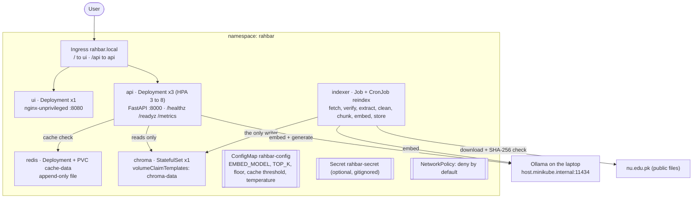

# Architecture

Two paths that never share a process (ADR 0001): the **indexer Job** writes a new index
generation and flips a pointer; the **API** reads whichever generation the pointer names on
each question. Both read `EMBED_MODEL` from the same ConfigMap, and the API refuses
readiness when the index was built with a different model (section 4.4).

## Objects

| Object | Name | Notes |
| --- | --- | --- |
| Namespace | `rahbar` | everything lives here, nothing in `default` |
| Deployment | `api` | 3 replicas, startup/liveness/readiness probes, `maxSurge: 1`, `maxUnavailable: 0`, preStop sleep, requests and limits |
| Deployment | `ui` | 1 replica, nginx-unprivileged, read-only root, `/tmp` emptyDir |
| StatefulSet | `chroma` | 1 replica, `volumeClaimTemplates` (2 Gi), `chromadb/chroma:1.0.12` |
| Deployment + PVC | `redis`, `cache-data` | semantic cache with append-only persistence, `Recreate` strategy |
| Job | `indexer` | `restartPolicy: OnFailure`, `backoffLimit: 3`, `activeDeadlineSeconds: 3600` |
| CronJob | `reindex` | weekly, same image and command as the Job, `concurrencyPolicy: Forbid` |
| Service x4 | `api`, `ui`, `chroma`, `redis` | all ClusterIP |
| Ingress | `rahbar` | host `rahbar.local`, `/api` to api, `/` to ui |
| ConfigMap | `rahbar-config` | chunking, top_k, relevance floor, cache threshold, temperature, EMBED_MODEL, LLM_PROVIDER, CHROMA_HOST |
| Secret | `rahbar-secret` | optional (ollama-host needs no key); placeholder only in Git |
| NetworkPolicy | 9 policies | deny all, DNS, then one rule per allowed path |
| HPA | `api` | CPU 70 %, min 3, max 8 |
| ServiceAccount x5 | one per workload | `automountServiceAccountToken: false` everywhere |

## Why Chroma is a StatefulSet, not a Deployment

Chroma is the one component whose data *is* the product: lose its volume and every answer
is gone until the next index run. A StatefulSet gives three guarantees a Deployment does
not:

1. **Stable identity bound to stable storage.** `volumeClaimTemplates` creates the claim
   `chroma-data-chroma-0` for the pod `chroma-0`. If the pod is deleted, rescheduled or
   upgraded, the replacement is again `chroma-0` and re-attaches the *same* claim. A
   Deployment's pods have random names, and its PVC is a separate object that all replicas
   would share.
2. **No two pods on one volume during a rollout.** A StatefulSet replaces `chroma-0` by
   terminating it before starting the new one. A Deployment's default rolling update starts
   the new pod first. With a ReadWriteOnce volume the new pod either cannot mount it and
   hangs, or, on a single node where RWO still allows it, two Chroma processes open the same
   SQLite and HNSW files at once and corrupt them.
3. **The claim outlives the workload.** Deleting or scaling the StatefulSet leaves the PVC
   in place by default, so `kubectl delete -k` followed by a re-apply comes back with the
   index intact.

Redis is a Deployment with `strategy: Recreate` and its own PVC, which is acceptable
because the cache is disposable by design: it is flushed on every re-index (ADR 0003).

## Network paths (deny by default)

| From | To | Port | Why |
| --- | --- | --- | --- |
| ingress-nginx | ui | 8080 | the chat page |
| ingress-nginx, ui | api | 8000 | `/api/ask` |
| api, indexer | chroma | 8000 | read (api), write (indexer) |
| api | redis | 6379 | semantic cache |
| api, indexer | Ollama host IP | 11434 | embeddings and generation (overlay-specific address) |
| indexer | internet | 80, 443 | corpus download from nu.edu.pk |
| every pod | kube-dns | 53 UDP/TCP | name resolution |

Anything else is dropped, including ui to chroma (demonstrated in `docs/evidence/`).
